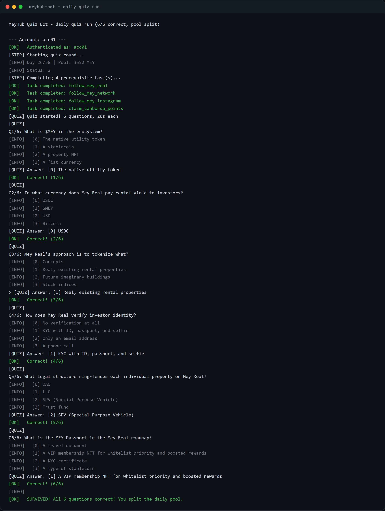

# MeyHub Quiz Bot

Daily knockout quiz automation for **Mey Network** airdrop on meyhub.io.

## What is Mey Network?

Mey Network is a global tokenized real estate platform on **Base chain** (L2).  
The $MEY token is already listed on MEXC, BingX, BitMart with ~$300K daily volume.  
Main site explicitly mentions **"airdrops"** for MEY Passport holders.

**MeyHub** (meyhub.io) is the community hub with:
- **MEY Property Investor Card** — claim for free
- **Mey Real Quiz** — 38-day daily knockout quiz, 6 questions/round, 20s per question
- **Daily Pool** — 3,552 MEY split among survivors
- **Referral System** — earn Resurrection Cards (save from elimination)
- **Leaderboard** — climb ranks for better rewards

## Features

- 🧠 **LLM-Powered Quiz** — auto-answers questions using AI (Bynara/OpenRouter/Groq)
- 🔄 **Daily Automation** — `--daily` flag for cron/scheduled runs
- 👛 **Multi-Wallet** — run quiz for multiple accounts
- 🔗 **Referral System** — auto-generate and track referral links
- 📊 **Status Dashboard** — check quiz status, leaderboard, tasks
- 🛡️ **Resurrection Cards** — track card balance (auto-saves first wrong answer)

## Requirements

| Item | Required? | Cost |
|------|-----------|------|
| Node.js 18+ | ✅ | Free |
| Twitter/X Account | ✅ | Free |
| Crypto Wallet (Base) | ✅ | Free (no gas needed) |
| Email Address | ✅ | Free |
| LLM API Key | ✅ | Free (Bynara: 7M tokens/day) |
| Proxy | ❌ | Optional |

## Cost Assessment

**Category: A — FREE ✅**

No real money needed. Only social engagement + quiz.

| Item | Cost |
|------|------|
| Twitter auth | Rp 0 |
| Wallet sign (Base) | Rp 0 (no gas) |
| Quiz | Rp 0 |
| LLM API | Rp 0 (Bynara free tier) |
| **Total per wallet** | **Rp 0** |

## Setup

```bash
# 1. Clone
git clone https://github.com/layerairdrop/meyhub-bot.git
cd meyhub-bot

# 2. Install
npm install

# 3. Configure
cp accounts.json.example accounts.json
cp .env.example .env

# 4. Edit accounts.json — add your wallets
# 5. Edit .env — add LLM API key

# 6. Run
node index.js
```

## Getting Cookie (Required)

MeyHub uses **Twitter OAuth 2.0 + PKCE** for auth. The server sets an **HttpOnly session cookie** after you authorize. You need to extract this cookie from your browser.

### Step-by-step:

1. Open https://meyhub.io/claim in Chrome
2. Click **"Connect with X"** → login Twitter → click **"Authorize"**
3. You'll be redirected back to meyhub.io/claim
4. Open **DevTools (F12)** → go to **Application** tab
5. Left sidebar: **Cookies** → click `https://meyhub.io`
6. Look for the session cookie (likely named one of):
   - `next-auth.session-token`
   - `__Secure-next-auth.session-token`
   - `meyhub.session`
   - `sid`
   - Or any **HttpOnly** cookie with a long value
7. Copy the **full cookie string**: `cookieName=cookieValue`

### Alternative (easier):

1. After OAuth redirect, open **DevTools (F12)** → **Network** tab
2. Refresh the page (F5)
3. Click any request to `/api/quiz/status` or `/api/leaderboard`
4. In the **Request Headers** section, find the **Cookie** header
5. Copy the **full Cookie header value** (everything after `Cookie: `)
6. Paste into `accounts.json` → `cookie` field

### Example cookie format:
```
next-auth.session-token=eyJhbGciOiJFUzI1NiIs...; __cf_bm=abc123...
```

## Usage

```
node index.js          # Interactive menu
node index.js --daily  # Auto-run quiz for all accounts
```

### Menu Options

```
[1] Auth (Twitter + Wallet)    — Complete auth flow
[2] Run Quiz (all accounts)    — Run quiz for all wallets
[3] Run Quiz (single account)  — Run quiz for one wallet
[4] Check Quiz Status          — View status + tasks + cards
[5] Get Referral Link          — Generate referral code
[6] Check Leaderboard          — View top players
[7] Run All                    — Quiz + referral for all
[0] Exit
```

## Quiz Rules

- **38-day** daily knockout quiz
- **6 questions** per round, **20 seconds** each
- **1 wrong answer** = eliminated (unless Resurrection Card)
- Survivors **split the daily 3,552 MEY pool**
- **1 attempt** per day
- **Resurrection Cards**: earned from referrals + 2-day task streaks

## Project Info

| Field | Value |
|-------|-------|
| Project | Mey Network |
| Token | MEY |
| Chain | Base (L2) |
| Contract | 0x8bFac1B375bF2894D6f12Fb2eB48B1c1A7916789 |
| Price | ~$0.047 |
| Market Cap | ~$12.6M |
| FDV | ~$108M |
| Campaign | Daily Quiz (38 days) |
| Airdrop | CONFIRMED (main site) |
| Website | mey.network |
| Hub | meyhub.io |
| Twitter | @Mey_Network / @MeyReal_io |
| Telegram | @Mey_Network (14K members) |

## File Structure

```
meyhub-bot/
├── index.js           # CLI menu + entry point
├── config.json        # Configuration
├── accounts.json      # Per-wallet: email, privateKey, cookie
├── .env               # LLM API key
├── src/
│   ├── api.js         # API client (cookie-based auth)
│   ├── auth.js        # Twitter OAuth + wallet connect
│   └── quiz.js        # Quiz engine + LLM integration
└── utils/
    ├── logger.js      # Colored console output
    ├── banner.js      # LYID watermark
    └── utils.js       # Helpers (delay, JSON, config)
```

## Bukti run (dari bot sendiri, bukan mockup)



Kartu di atas dirender dari `logs.txt` milik bot — run kuis harian yang benar-benar terjadi:
4 task prasyarat selesai, 6/6 jawaban benar, `SURVIVED! All 6 questions correct! You split the
daily pool` (pool hari itu 3.552 MEY). Email akun di-mask jadi `acc01`.

Catatan jujur: cookie sesi akun di `accounts.json` sekarang sudah expired ("Session expired.
Re-authenticate in browser"), jadi kartu ini adalah run terakhir yang tercatat, bukan run baru.
Untuk run baru, ambil ulang cookie lewat langkah di bagian *Getting Cookie*.

## Troubleshooting

| Issue | Solution |
|-------|----------|
| 401 Unauthorized | Cookie expired. Re-authenticate in browser. |
| Quiz not starting | Complete prerequisite tasks first (option 4 to check). |
| LLM returns wrong answer | Set a better LLM model in config.json. |
| "Already completed today" | Quiz is 1 attempt/day. Come back tomorrow. |
| No Resurrection Cards | Refer friends or maintain 2-day task streaks. |

## Contact

- Telegram: @rmndkyl
- GitHub: @rmndkyl
- Channel: @layerairdrop

---

**Layer Airdrop ID (LYID)** — Automated airdrop farming made easy.
